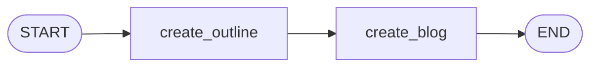

# 🦜🕸️ Agent_LangGraph: Learning & Building with LangGraph

A structured, hands-on repository documenting my journey learning **LangGraph** — from fundamental sequential graphs to complex multi-agent architectures, stateful memory, and agentic workflows.

---

## 📌 Repository Roadmap & Learning Tracker

| # | Topic / Pattern | Notebook / Code | Status | Description |
|---|-----------------|-----------------|:------:|-------------|
| 1 | **Sequential Workflow** | [`bmi_workflow.ipynb`](file:///Sequential_Workflow/bmi_workflow.ipynb)<br>[`simple_llm_workflow.ipynb`](file:///Sequential_Workflow/simple_llm_workflow.ipynb)<br>[`prompt_chaining.ipynb`](file:///Sequential_Workflow/prompt_chaining.ipynb) | ✅ Completed | Linear graphs: Pure Python logic, single-node LLM calls, and multi-step LLM prompt chaining (Outline ➔ Blog generation) |
| 2 | **Parallel Workflow** | [`batsman_workflow.ipynb`](file:///Parallel_Workflow/batsman_workflow.ipynb) | ✅ Completed | Fan-out / Fan-in parallel graph: Multiple independent calculations running concurrently and merging into a summary node |
| 3 | **Conditional Edges** | `TBD` | ⏳ Upcoming | Dynamic branching based on state inspection |
| 4 | **Cycles & Loops (Agentic loops)** | `TBD` | ⏳ Upcoming | Iterative problem solving with reflection and loop counters |
| 5 | **Tool Calling & External APIs** | `TBD` | ⏳ Upcoming | Integrating LLMs with custom and prebuilt tools |
| 6 | **Memory & Checkpointing** | `TBD` | ⏳ Upcoming | State persistence, thread-level checkpointing, and time travel |
| 7 | **Human-in-the-Loop (HITL)** | `TBD` | ⏳ Upcoming | Interrupts, approvals, and human state editing |
| 8 | **Multi-Agent Systems** | `TBD` | ⏳ Upcoming | Supervisor, hierarchical, and collaborative agent workflows |

---

## 📂 Project Structure

```text
Agent_LangGraph/
├── .env.example                  # Environment variables template
├── .gitignore                    # Git ignore configuration
├── requirements.txt              # Python dependencies
├── README.md                     # Project documentation & learning tracker
├── Sequential_Workflow/          # Module 1: Sequential graphs
│   ├── bmi_workflow.ipynb        # BMI calculation & category labeling graph
│   ├── simple_llm_workflow.ipynb # Single-node LLM query graph
│   └── prompt_chaining.ipynb     # Multi-step LLM prompt chaining graph (Outline -> Blog)
└── Parallel_Workflow/            # Module 2: Parallel graphs (Fan-out / Fan-in)
    └── batsman_workflow.ipynb    # Cricket batsman performance metrics graph
```

---

## 🔍 Module 1: Sequential Workflow

Sequential workflows execute nodes in a fixed, linear order (`START` ➔ `Node A` ➔ `Node B` ➔ ... ➔ `END`).

### 1. BMI Calculator (`bmi_workflow.ipynb`)
Demonstrates state definitions and pure Python transformations across nodes.


### 2. Simple LLM Workflow (`simple_llm_workflow.ipynb`)
Demonstrates integrating an LLM (via `ChatGroq`) directly within a LangGraph node.


### 3. Prompt Chaining (`prompt_chaining.ipynb`)
Demonstrates sequential LLM pipeline chaining where each node transforms and enriches state for the next LLM call (Blog Title ➔ Outline Generator ➔ Content Generator).


---

## ⚡ Module 2: Parallel Workflow

Parallel workflows execute multiple independent nodes concurrently from a single predecessor (**Fan-Out**) and aggregate their outputs into a single downstream node (**Fan-In**).

### Batsman Performance Analyzer (`batsman_workflow.ipynb`)
Demonstrates parallel execution of independent metrics calculations and automatic state merging.

#### 1. Graph Flow


#### 2. Key Concepts Demonstrated
- **Fan-Out**: Multiple edges leaving `START` trigger simultaneous execution of independent metric calculators.
- **State Partitioning**: Each parallel node computes a distinct key in `BatsmanState` (`strike_rate`, `balls_per_boundary`, `boundary_percent`) without conflicting writes.
- **Fan-In (Barrier Synchronization)**: The `summary` node automatically waits until all parallel nodes complete before executing and synthesizing the final output.

---

## 🚀 Getting Started

### 1. Clone the Repository
```bash
git clone https://github.com/shubhamdz/Agent_LangGraph.git
cd Agent_LangGraph
```

### 2. Set Up Virtual Environment
```bash
python3 -m venv .venv
source .venv/bin/activate
```

### 3. Install Dependencies
```bash
pip install -r requirements.txt
```

### 4. Configure Environment Variables (Optional)
Copy `.env.example` to `.env` and configure your API keys if working with LLMs:
```bash
cp .env.example .env
```

### 5. Launch Jupyter Notebook
```bash
jupyter notebook
# or open in VS Code / Cursor and select the .venv kernel
```

---

## 🛠️ Tech Stack & Dependencies

- **Framework**: [LangGraph](https://github.com/langchain-ai/langgraph), [LangChain](https://github.com/langchain-ai/langchain)
- **Language**: Python 3.10+
- **Environment**: Jupyter Notebook / IPython
