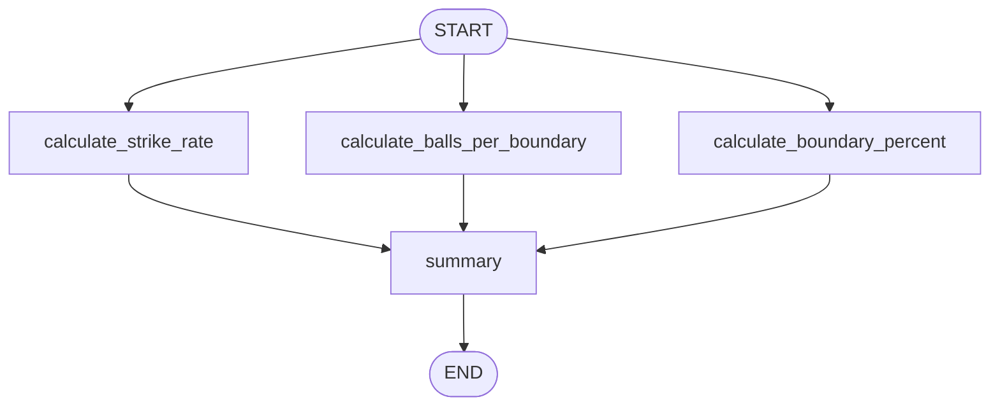
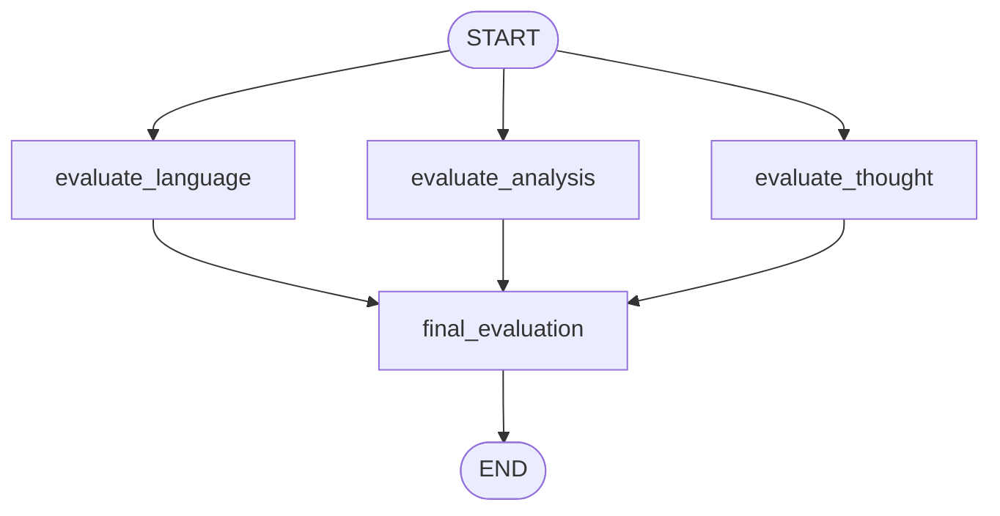
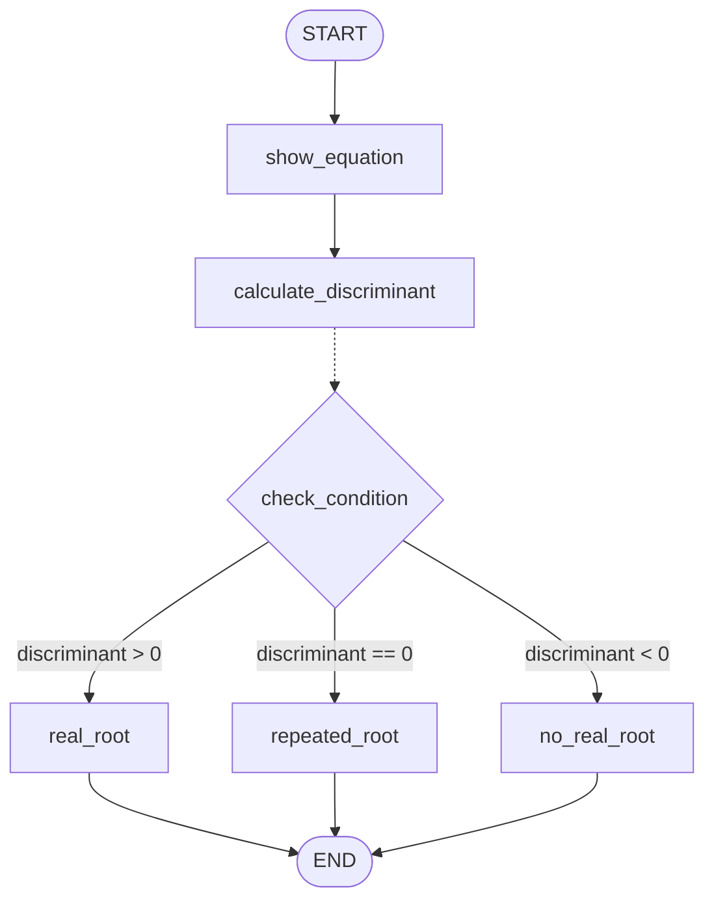
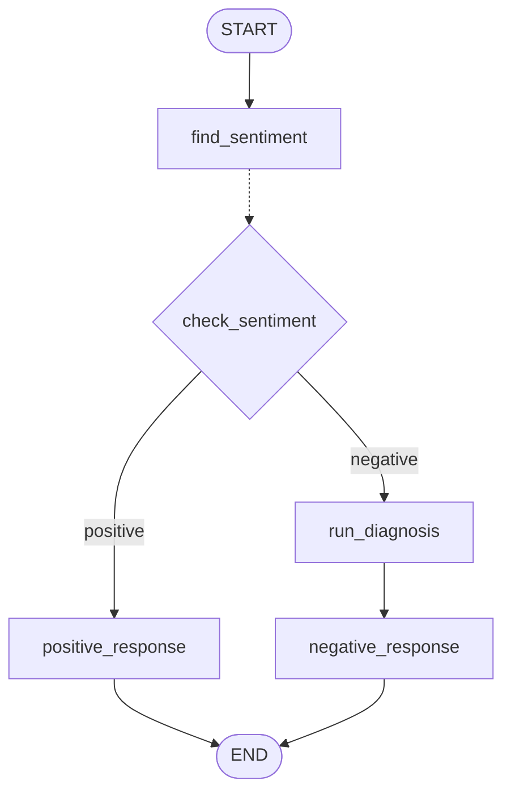
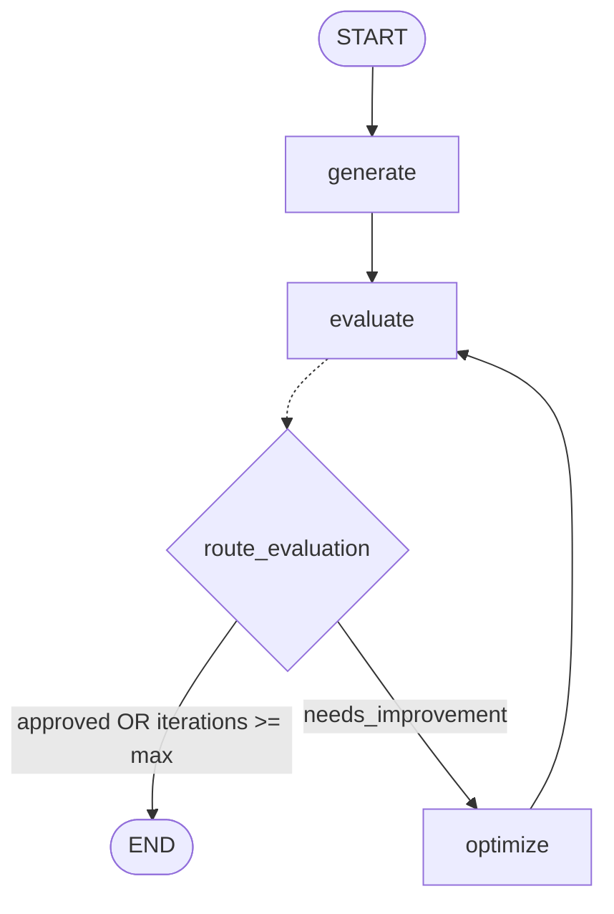
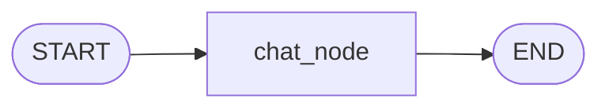

# 🦜🕸️ Agent_LangGraph: Learning & Building with LangGraph

A structured, hands-on repository documenting my journey learning **LangGraph** — from fundamental sequential graphs to complex multi-agent architectures, stateful memory, and agentic workflows.

---

## 📌 Repository Roadmap & Learning Tracker

| # | Topic / Pattern | Notebook / Code | Status | Description |
|---|-----------------|-----------------|:------:|-------------|
| 1 | **Sequential Workflow** | [`bmi_workflow.ipynb`](file:///Sequential_Workflow/bmi_workflow.ipynb)<br>[`simple_llm_workflow.ipynb`](file:///Sequential_Workflow/simple_llm_workflow.ipynb)<br>[`prompt_chaining.ipynb`](file:///Sequential_Workflow/prompt_chaining.ipynb) | ✅ Completed | Linear graphs: Pure Python logic, single-node LLM calls, and multi-step LLM prompt chaining (Outline ➔ Blog generation) |
| 2 | **Parallel Workflow** | [`batsman_workflow.ipynb`](file:///Parallel_Workflow/batsman_workflow.ipynb)<br>[`upsc_essay_workflow.ipynb`](file:///Parallel_Workflow/upsc_essay_workflow.ipynb) | ✅ Completed | Fan-out / Fan-in parallel graphs: Independent computations and multi-aspect LLM evaluation with state reducers (`operator.add`) |
| 3 | **Conditional Workflow** | [`quadratic_workflow.ipynb`](file:///Conditional_Workflow/quadratic_workflow.ipynb)<br>[`review_reply_workflow.ipynb`](file:///Conditional_Workflow/review_reply_workflow.ipynb) | ✅ Completed | Dynamic branching via `add_conditional_edges`: Deterministic math routing and LLM sentiment-driven support response generation |
| 4 | **Iterative Workflow (Loops & Cycles)** | [`X_post_generator.ipynb`](file:///Iterative_Workflow/X_post_generator.ipynb) | ✅ Completed | Agentic reflection loops: Generate ➔ Critique ➔ Optimize cycle with max iteration guardrails & state reducers |
| 5 | **Conversational Workflow (Memory & Persistence)** | [`basic_chatbot.ipynb`](file:///Conversational_Workflow/basic_chatbot.ipynb) | ✅ Completed | Stateful chat agent with `MemorySaver` checkpointer, message history reducer (`add_messages`), and multi-turn thread session management |
| 6 | **Tool Calling & External APIs** | `TBD` | ⏳ Upcoming | Integrating LLMs with custom and prebuilt tools |
| 7 | **Human-in-the-Loop (HITL)** | `TBD` | ⏳ Upcoming | Interrupts, approvals, and human state editing |
| 8 | **Multi-Agent Systems** | `TBD` | ⏳ Upcoming | Supervisor, hierarchical, and collaborative agent workflows |

---

## 📂 Project Structure

```text
Agent_LangGraph/
├── .env.example                  # Environment variables template
├── .gitignore                    # Git ignore configuration
├── requirements.txt              # Python dependencies
├── README.md                     # Project documentation & learning tracker
├── Sequential_Workflow/          # Module 1: Sequential graphs
│   ├── bmi_workflow.ipynb        # BMI calculation & category labeling graph
│   ├── simple_llm_workflow.ipynb # Single-node LLM query graph
│   └── prompt_chaining.ipynb     # Multi-step LLM prompt chaining graph (Outline -> Blog)
├── Parallel_Workflow/            # Module 2: Parallel graphs (Fan-out / Fan-in)
│   ├── batsman_workflow.ipynb    # Cricket batsman performance metrics graph
│   └── upsc_essay_workflow.ipynb # Multi-criteria parallel LLM essay evaluation graph
├── Conditional_Workflow/         # Module 3: Conditional branching graphs
│   ├── quadratic_workflow.ipynb  # Quadratic equation root solver with dynamic routing
│   └── review_reply_workflow.ipynb # Customer review sentiment analysis & diagnosis router
├── Iterative_Workflow/           # Module 4: Agentic loops & reflection cycles
│   └── X_post_generator.ipynb    # Viral tweet generator with critique and self-correction loop
└── Conversational_Workflow/      # Module 5: Conversational agents & persistence
    └── basic_chatbot.ipynb       # Stateful multi-turn chatbot with memory checkpointing
```

---

## 🔍 Module 1: Sequential Workflow

Sequential workflows execute nodes in a fixed, linear order (`START` ➔ `Node A` ➔ `Node B` ➔ ... ➔ `END`).

### 1. BMI Calculator (`bmi_workflow.ipynb`)
Demonstrates state definitions and pure Python transformations across nodes.


### 2. Simple LLM Workflow (`simple_llm_workflow.ipynb`)
Demonstrates integrating an LLM (via `ChatGroq`) directly within a LangGraph node.


### 3. Prompt Chaining (`prompt_chaining.ipynb`)
Demonstrates sequential LLM pipeline chaining where each node transforms and enriches state for the next LLM call (Blog Title ➔ Outline Generator ➔ Content Generator).


---

## ⚡ Module 2: Parallel Workflow

Parallel workflows execute multiple independent nodes concurrently from a single predecessor (**Fan-Out**) and aggregate their outputs into a single downstream node (**Fan-In**).

### 1. Batsman Performance Analyzer (`batsman_workflow.ipynb`)
Demonstrates parallel execution of independent metrics calculations and automatic state merging.

#### Graph Flow


#### Key Concepts Demonstrated
- **Fan-Out**: Multiple edges leaving `START` trigger simultaneous execution of independent metric calculators.
- **State Partitioning**: Each parallel node computes a distinct key in `BatsmanState` (`strike_rate`, `balls_per_boundary`, `boundary_percent`) without conflicting writes.
- **Fan-In (Barrier Synchronization)**: The `summary` node automatically waits until all parallel nodes complete before executing and synthesizing the final output.

### 2. UPSC Essay Evaluator (`upsc_essay_workflow.ipynb`)
Demonstrates parallel LLM evaluations with Pydantic structured output and **State Reducers** (`operator.add`) for handling concurrent list updates.

#### Graph Flow


#### Key Concepts Demonstrated
- **Parallel LLM Evaluations**: Runs 3 distinct evaluators (Language, Depth of Analysis, Clarity of Thought) concurrently using `ChatGroq` with `with_structured_output(EvaluationSchema)`.
- **State Reducers (`Annotated[list, operator.add]`)**: Solves concurrent write conflicts when parallel nodes append their individual scores into a shared list.
- **Consolidated Synthesis**: `final_evaluation` calculates average scores and generates a comprehensive overall review.

---

## 🔀 Module 3: Conditional Workflow

Conditional workflows implement dynamic branching logic using conditional edges (`add_conditional_edges`). The graph inspects the current state at runtime and routes execution to specific downstream nodes based on condition functions returning string identifiers / `Literal` types.

### 1. Quadratic Equation Solver (`quadratic_workflow.ipynb`)
Demonstrates mathematical condition checking based on the discriminant ($b^2 - 4ac$) to route execution to appropriate root-finding nodes.

#### Graph Flow


#### Key Concepts Demonstrated
- **Router Function (`check_condition`)**: Uses typing `Literal['no_real_root', 'real_root', 'repeated_root']` to map state evaluation cleanly to downstream target node names.
- **Conditional Edges**: Attached via `graph.add_conditional_edges('calculate_discriminant', check_condition)`.
- **Terminal Edge Convergence**: Each distinct branching path routes cleanly to `END`.

### 2. Customer Review Reply & Diagnosis Workflow (`review_reply_workflow.ipynb`)
Demonstrates LLM-driven conditional routing where customer reviews are evaluated for sentiment, triggering either an immediate response or a multi-step diagnostic sub-branch.

#### Graph Flow


#### Key Concepts Demonstrated
- **Structured LLM Classification**: Classifies review sentiment with `ChatGroq` using Pydantic `SentimentSchema` (`Literal['positive', 'negative']`).
- **Dynamic Branch Selection**: `check_sentiment` routes positive reviews directly to `positive_response` and negative reviews to `run_diagnosis`.
- **Multi-Step Conditional Pipelines**: Negative feedback flows through a 2-step resolution chain: detailed diagnostic extraction (issue type, tone, urgency) followed by an empathetic, tailored response.

---

## 🔁 Module 4: Iterative Workflow (Cycles & Loops)

Iterative workflows introduce cyclic graphs (agentic loops) where an agent generates output, another node critiques or evaluates it, and an optimizer refines it in a loop until a quality threshold or maximum iteration limit is reached (**Generate-Evaluate-Optimize pattern**).

### Viral Tweet Generator & Optimizer (`X_post_generator.ipynb`)
Demonstrates an iterative self-correction loop featuring a generator, a strict critic with structured output, and a virality optimizer.

#### Graph Flow


#### Key Concepts Demonstrated
- **Agentic Reflection Cycles**: The cyclic edge `optimize -> evaluate` creates an iterative refinement loop that mimics human draft revision.
- **Loop Termination Guardrails**: `route_evaluation` prevents infinite loops by checking approval status OR safety cutoff (`iterations >= max_iterations`).
- **State History with Reducers**: `tweet_history: Annotated[list[str], operator.add]` and `feedback_history: Annotated[list[str], operator.add]` track the full evolution of drafts and critique feedback across iterations.
- **Specialized Multi-LLM Personas**: Leverages distinct models and prompts for generation (`openai/gpt-oss-20b`), critique (`openai/gpt-oss-120b` with structured output schema), and refinement (`qwen/qwen3.8-27b`).

---

## 💬 Module 5: Conversational Workflow (Memory & Persistence)

Conversational workflows introduce stateful dialog agents with memory persistence. By leveraging LangGraph's checkpointer mechanism (`MemorySaver`), the graph persists state across invocations, enabling multi-turn conversations grouped by a unique session `thread_id`.

### Basic Stateful Chatbot (`basic_chatbot.ipynb`)
Demonstrates an interactive multi-turn conversational agent with thread-scoped memory and message history management.

#### Graph Flow


#### Key Concepts Demonstrated
- **Message Reducer (`add_messages`)**: `messages: Annotated[list[BaseMessage], add_messages]` automatically appends incoming human and AI messages to the existing conversation context without manual concatenation.
- **Checkpointer & Thread Management**: Compiled with `MemorySaver()` checkpointer. Passing `config = {'configurable': {'thread_id': '1'}}` isolates conversation states per user or thread.
- **Context Retention**: Maintains conversational continuity across independent invocations within a persistent interactive loop.

---

## 🚀 Getting Started

### 1. Clone the Repository
```bash
git clone https://github.com/shubhamdz/Agent_LangGraph.git
cd Agent_LangGraph
```

### 2. Set Up Virtual Environment
```bash
python3 -m venv .venv
source .venv/bin/activate
```

### 3. Install Dependencies
```bash
pip install -r requirements.txt
```

### 4. Configure Environment Variables (Optional)
Copy `.env.example` to `.env` and configure your API keys if working with LLMs:
```bash
cp .env.example .env
```

### 5. Launch Jupyter Notebook
```bash
jupyter notebook
# or open in VS Code / Cursor and select the .venv kernel
```

---

## 🛠️ Tech Stack & Dependencies

- **Framework**: [LangGraph](https://github.com/langchain-ai/langgraph), [LangChain](https://github.com/langchain-ai/langchain)
- **Language**: Python 3.10+
- **Environment**: Jupyter Notebook / IPython
