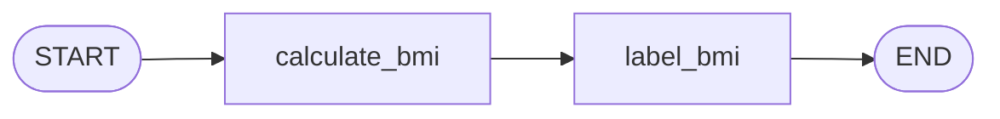

# 🦜🕸️ Agent_LangGraph: Learning & Building with LangGraph

A structured, hands-on repository documenting my journey learning **LangGraph** — from fundamental sequential graphs to complex multi-agent architectures, stateful memory, and agentic workflows.

---

## 📌 Repository Roadmap & Learning Tracker

| # | Topic / Pattern | Notebook / Code | Status | Description |
|---|-----------------|-----------------|:------:|-------------|
| 1 | **Sequential Workflow** | [`bmi_workflow.ipynb`](file:///Sequential_Workflow/bmi_workflow.ipynb) | ✅ Completed | Basic linear graph: State definition, calculation node, classification node, and compilation |
| 2 | **Conditional Edges** | `TBD` | ⏳ Upcoming | Dynamic branching based on state inspection |
| 3 | **Cycles & Loops (Agentic loops)** | `TBD` | ⏳ Upcoming | Iterative problem solving with reflection and loop counters |
| 4 | **Tool Calling & External APIs** | `TBD` | ⏳ Upcoming | Integrating LLMs with custom and prebuilt tools |
| 5 | **Memory & Checkpointing** | `TBD` | ⏳ Upcoming | State persistence, thread-level checkpointing, and time travel |
| 6 | **Human-in-the-Loop (HITL)** | `TBD` | ⏳ Upcoming | Interrupts, approvals, and human state editing |
| 7 | **Multi-Agent Systems** | `TBD` | ⏳ Upcoming | Supervisor, hierarchical, and collaborative agent workflows |

---

## 📂 Project Structure

```text
Agent_LangGraph/
├── .env.example              # Environment variables template
├── .gitignore                # Git ignore configuration
├── requirements.txt          # Python dependencies
├── README.md                 # Project documentation & learning tracker
└── Sequential_Workflow/      # Module 1: Sequential graphs
    └── bmi_workflow.ipynb    # BMI calculation & category labeling graph
```

---

## 🔍 Module 1: Sequential Workflow

A sequential workflow runs nodes in a fixed, linear order (`START` ➔ `Node A` ➔ `Node B` ➔ `END`).

### Example: BMI Calculator Graph
Located in: [`Sequential_Workflow/bmi_workflow.ipynb`](file:///Sequential_Workflow/bmi_workflow.ipynb)

#### 1. Graph Flow


#### 2. Key Concepts Demonstrated
- **Graph State**: Defining typed schema with `typing.TypedDict` (`weight_kg`, `height_m`, `bmi`, `category`).
- **Nodes**: Pure Python functions that accept the current state and return state updates.
- **Edges**: Connecting nodes via `graph.add_edge()` using `START` and `END` sentinel nodes.
- **Compilation & Execution**: Compiling with `graph.compile()` and invoking via `workflow.invoke()`.

---

## 🚀 Getting Started

### 1. Clone the Repository
```bash
git clone https://github.com/shubhamdz/Agent_LangGraph.git
cd Agent_LangGraph
```

### 2. Set Up Virtual Environment
```bash
python3 -m venv .venv
source .venv/bin/activate
```

### 3. Install Dependencies
```bash
pip install -r requirements.txt
```

### 4. Configure Environment Variables (Optional)
Copy `.env.example` to `.env` and configure your API keys if working with LLMs:
```bash
cp .env.example .env
```

### 5. Launch Jupyter Notebook
```bash
jupyter notebook
# or open in VS Code / Cursor and select the .venv kernel
```

---

## 🛠️ Tech Stack & Dependencies

- **Framework**: [LangGraph](https://github.com/langchain-ai/langgraph), [LangChain](https://github.com/langchain-ai/langchain)
- **Language**: Python 3.10+
- **Environment**: Jupyter Notebook / IPython
